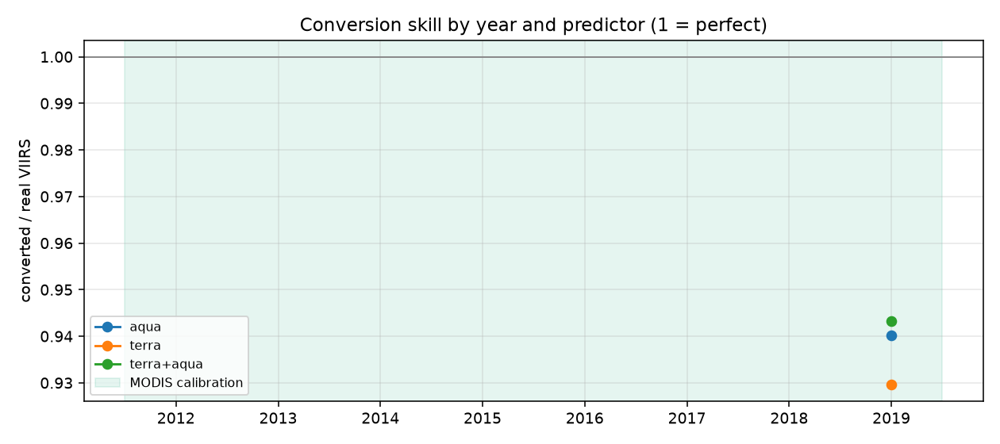
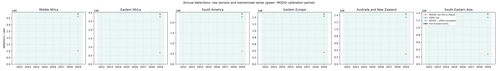
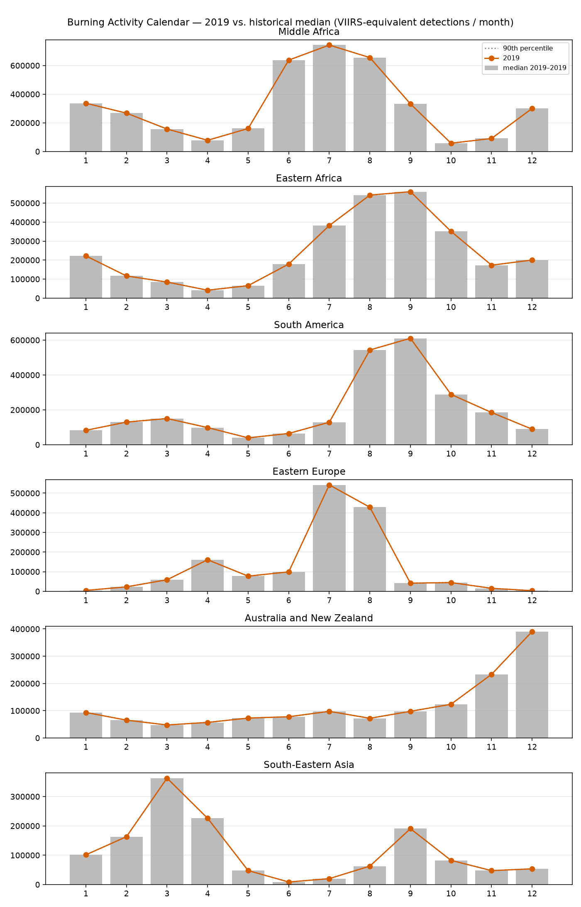

# Harmonization report — World

Grid: EPSG:6933 (global equal-area), 117 processing tiles, factor scale 5km · Reference: VIIRS S-NPP · QC: Q1 · K = 50 · day/night factors: **split** · 213 regions in 24 super-regions

## 1. Sources and availability

Calibration window and train/test cut per predictor (month resolution):

| predictor | calibration_from | calibration_to | test_from |
|---|---|---|---|
| noaa-20 | 2019-01 | 2019-12 | 2019-09 |
| terra+aqua | 2019-01 | 2019-12 | 2019-09 |
| terra | 2019-01 | 2019-12 | 2019-09 |
| aqua | 2019-01 | 2019-12 | 2019-09 |

Days by source of the harmonized series: S-NPP (reference) 365

No outage found by the screening of domain-wide daily counts, none listed in the outages file.

## 2. Conversion factors (1 predictor detection = f reference detections), 90% bootstrap interval

| config | f_n | ci05 | ci95 | n_months | m_total | v_total |
|---|---|---|---|---|---|---|
| aqua | 6.32 | 6.05 | 6.54 | 12 | 2 741 488 | 17 317 258 |
| terra | 12.1 | 11.7 | 12.6 | 12 | 1 427 716 | 17 317 258 |
| terra+aqua | 4.15 | 4.02 | 4.28 | 12 | 4 169 204 | 17 317 258 |

By day / night:

| config | dn | f_n | ci05 | ci95 | m_total | v_total |
|---|---|---|---|---|---|---|
| aqua | D | 4.99 | 4.82 | 5.18 | 2 588 312 | 12 918 119 |
| aqua | N | 28.7 | 26.6 | 31.1 | 153 176 | 4 399 139 |
| terra | D | 12.0 | 11.4 | 12.6 | 1 077 789 | 12 918 119 |
| terra | N | 12.6 | 11.9 | 13.3 | 349 927 | 4 399 139 |
| terra+aqua | D | 3.52 | 3.42 | 3.63 | 3 666 101 | 12 918 119 |
| terra+aqua | N | 8.74 | 8.33 | 9.24 | 503 103 | 4 399 139 |

By super-region (terra+aqua):

| super | f_n | ci05 | ci95 | m_total | v_total |
|---|---|---|---|---|---|
| Australia and New Zealand | 4.92 | 4.65 | 5.07 | 290 715 | 1 429 332 |
| Caribbean | 4.67 | 4.32 | 5.18 | 6 117 | 28 543 |
| Central America | 4.21 | 4.08 | 4.46 | 107 543 | 453 263 |
| Central Asia | 3.46 | 3.11 | 3.78 | 51 493 | 177 967 |
| Eastern Africa | 4.30 | 4.02 | 4.60 | 678 817 | 2 917 585 |
| Eastern Asia | 4.15 | 3.71 | 4.66 | 68 159 | 282 926 |
| Eastern Europe | 4.24 | 3.30 | 4.74 | 353 348 | 1 498 567 |
| Melanesia | 5.34 | 5.14 | 5.63 | 6 318 | 33 717 |
| Micronesia | 7.54 | 4.67 | 11.2 | 24 | 181 |
| Middle Africa | 3.69 | 3.51 | 3.96 | 1 033 357 | 3 817 038 |
| Northern Africa | 4.44 | 4.21 | 5.13 | 38 287 | 170 055 |
| Northern America | 3.99 | 3.49 | 4.35 | 131 382 | 524 735 |
| Northern Europe | 5.25 | 4.64 | 6.80 | 1 213 | 6 363 |
| Polynesia | 9.22 | 4.29 | 40.5 | 9 | 83 |
| South America | 3.85 | 3.76 | 3.90 | 626 712 | 2 410 455 |
| South-Eastern Asia | 4.96 | 4.79 | 5.18 | 275 314 | 1 366 899 |
| Southern Africa | 3.90 | 3.69 | 4.03 | 51 988 | 202 874 |
| Southern Asia | 5.47 | 5.16 | 5.76 | 90 329 | 494 054 |
| Southern Europe | 3.67 | 3.51 | 3.87 | 14 909 | 54 691 |
| Western Africa | 4.19 | 3.87 | 4.53 | 308 703 | 1 294 060 |
| Western Asia | 4.44 | 4.17 | 4.86 | 31 557 | 139 963 |
| Western Europe | 4.75 | 4.01 | 6.01 | 2 910 | 13 820 |

## 3. Held-out validation inside the calibration window (cell-month, factors fitted on the train part)

| config | cell_months | raw_ratio | harm_ratio | mae_raw | mae_harm | pearson | spearman_both | r_region_month | modis_miss |
|---|---|---|---|---|---|---|---|---|---|
| aqua | 989 748 | 0.15 | 1.00 | 4.92 | 5.09 | 0.77 | 0.54 | 0.99 | 0.62 |
| terra | 989 748 | 0.08 | 1.01 | 5.26 | 6.46 | 0.71 | 0.51 | 0.99 | 0.75 |
| terra+aqua | 989 748 | 0.24 | 0.99 | 4.60 | 4.46 | 0.83 | 0.60 | 0.99 | 0.56 |

Day/night split against one pooled factor, same held-out cell-months:

| config | daynight | harm_ratio | mae_harm | pearson | r_region_month |
|---|---|---|---|---|---|
| aqua | pooled | 0.98 | 5.00 | 0.77 | 0.98 |
| aqua | split | 1.00 | 5.09 | 0.77 | 0.99 |
| terra | pooled | 1.01 | 6.45 | 0.70 | 0.99 |
| terra | split | 1.01 | 6.46 | 0.71 | 0.99 |
| terra+aqua | pooled | 0.98 | 4.40 | 0.83 | 0.99 |
| terra+aqua | split | 0.99 | 4.46 | 0.83 | 0.99 |

For terra+aqua the lower cell-month error is obtained with **pooled** factors (configured: split; change `harmonization.daynight` if they differ).

| super | cell_months | raw_ratio | harm_ratio | mae_raw | mae_harm | pearson | spearman_both | r_region_month | modis_miss |
|---|---|---|---|---|---|---|---|---|---|
| Australia and New Zealand | 30 864 | 0.19 | 1.12 | 22.4 | 15.4 | 0.87 | 0.76 | 1.00 | 0.33 |
| Caribbean | 1 969 | 0.18 | 0.79 | 1.89 | 2.42 | 0.53 | 0.39 | 0.98 | 0.77 |
| Central America | 10 614 | 0.27 | 1.06 | 1.75 | 2.56 | 0.68 | 0.36 | 0.99 | 0.72 |
| Central Asia | 6 703 | 0.30 | 0.98 | 3.35 | 3.83 | 0.64 | 0.59 | 1.00 | 0.55 |
| Eastern Africa | 212 623 | 0.21 | 0.89 | 4.94 | 4.67 | 0.67 | 0.49 | 0.99 | 0.54 |
| Eastern Asia | 36 264 | 0.27 | 1.06 | 1.79 | 2.77 | 0.26 | 0.33 | 0.99 | 0.69 |
| Eastern Europe | 33 474 | 0.30 | 1.00 | 2.65 | 3.26 | 0.62 | 0.52 | 0.99 | 0.58 |
| Melanesia | 7 961 | 0.19 | 1.03 | 2.47 | 3.35 | 0.59 | 0.37 | 1.00 | 0.71 |
| Micronesia | 2 | 2.00 | 9.76 | 1.50 | 5.38 | – | – | – | 0.50 |
| Middle Africa | 142 865 | 0.27 | 0.97 | 4.29 | 4.20 | 0.69 | 0.56 | 0.99 | 0.50 |
| Northern Africa | 18 258 | 0.25 | 0.94 | 4.49 | 4.67 | 0.60 | 0.45 | 1.00 | 0.52 |
| Northern America | 32 846 | 0.28 | 0.98 | 2.92 | 3.34 | 0.83 | 0.53 | 0.99 | 0.59 |
| Northern Europe | 503 | 0.09 | 0.57 | 1.68 | 2.26 | 0.32 | 0.48 | 0.89 | 0.89 |
| Polynesia | 21 | 0.21 | 0.75 | 1.38 | 2.00 | -0.67 | – | -0.72 | 0.81 |
| Seven seas (open ocean) | 2 | 0 | 0 | 4.00 | 4.00 | – | – | – | 1.00 |
| South America | 244 246 | 0.26 | 0.96 | 3.95 | 3.89 | 0.81 | 0.56 | 1.00 | 0.57 |
| South-Eastern Asia | 68 754 | 0.21 | 1.03 | 4.58 | 4.23 | 0.92 | 0.59 | 1.00 | 0.65 |
| Southern Africa | 15 714 | 0.25 | 1.03 | 4.09 | 4.81 | 0.61 | 0.55 | 0.99 | 0.54 |
| Southern Asia | 29 189 | 0.19 | 0.82 | 3.13 | 3.18 | 0.67 | 0.59 | 0.98 | 0.70 |
| Southern Europe | 6 782 | 0.29 | 1.02 | 2.39 | 2.82 | 0.74 | 0.56 | 1.00 | 0.63 |
| Unassigned | 15 | 0 | 0 | 1.53 | 1.53 | – | – | – | 1.00 |
| Western Africa | 69 858 | 0.27 | 1.21 | 4.18 | 5.05 | 0.63 | 0.54 | 0.98 | 0.48 |
| Western Asia | 18 891 | 0.25 | 0.94 | 2.73 | 3.54 | 0.55 | 0.42 | 0.95 | 0.64 |
| Western Europe | 1 330 | 0.19 | 0.99 | 1.99 | 3.11 | 0.22 | 0.42 | 0.99 | 0.74 |

## 4. Conversion skill by year (after the calibration window = drift check; last year = independent)

| year | conv/ref aqua | conv/ref terra | conv/ref terra+aqua |
|---|---|---|---|
| 2019 | 0.94 | 0.93 | 0.94 |

By super-region (terra+aqua):

| year | Australia and New Zealand | Caribbean | Central America | Central Asia | Eastern Africa | Eastern Asia | Eastern Europe | Melanesia | Micronesia | Middle Africa | Northern Africa | Northern America | Northern Europe | Polynesia | Seven seas (open ocean) | South America | South-Eastern Asia | Southern Africa | Southern Asia | Southern Europe | Unassigned | Western Africa | Western Asia | Western Europe |
|---|---|---|---|---|---|---|---|---|---|---|---|---|---|---|---|---|---|---|---|---|---|---|---|---|
| 2019 | 0.94 | 0.91 | 0.94 | 0.94 | 0.95 | 0.93 | 0.96 | 0.93 | 0.67 | 0.95 | 0.91 | 0.93 | 0.92 | 0.34 | 0 | 0.94 | 0.93 | 0.94 | 0.93 | 0.92 | 0 | 0.94 | 0.86 | 0.88 |

Sensor ratio reference / predictor by day and night (a drift confined to one half points to overpass time):

| year | D | N |
|---|---|---|
| 2019 | 3.52 | 8.74 |

Largest region-month departures after 2019 (terra+aqua, ≥ 500 reference detections):

none above the threshold.

## 5. Annual series

## 6. Burning Activity Calendar — 2019

## 7. Checks and uncertainty

- 1km series not written (`harmonization.fine_scale: false`)

- Factor level used on converted cell-days: 

- Dispersion on held-out cell-months φ = 2.7 (terra+aqua). Approximate 90% interval of a local factor: f · exp(± 1.645 · √φ · f_se), `f_se` being stored with every factor and every harmonized cell-day (`mvh.harmonize.interval`).

## Summary

- terra+aqua factor **4.15** (90%: 4.02–4.28).

- Held-out converted / reference = **0.99** (raw 0.24); region-month correlation r = 0.99; cell-month Pearson 0.83.

- Limit: in 56% of the cell-months seen by the reference, the predictor detected nothing (small fires). A multiplier cannot create these fires, so the cell-month absolute error (MAE 4.6 → 4.5) does not improve much. The factor gets totals and the region/month pattern right; individual cell-month values remain highly uncertain.
