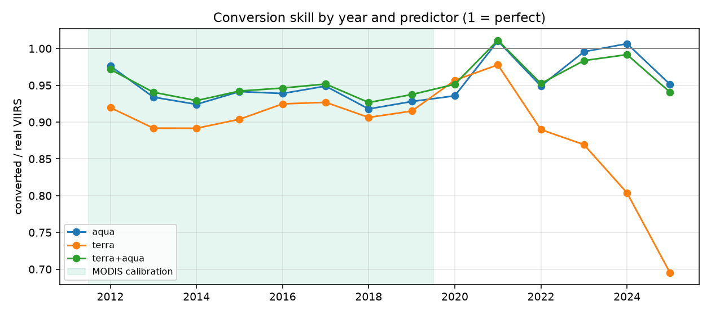
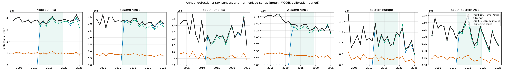
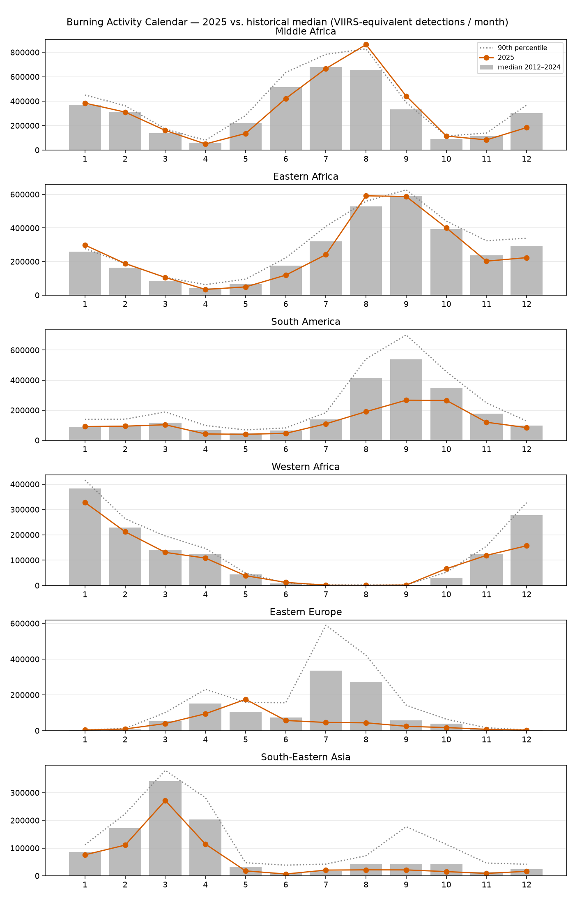

# Harmonization report — World

Grid: EPSG:6933 (global equal-area), 126 processing tiles, factor scale 5km · Reference: VIIRS S-NPP · QC: Q1 · K = 50 · day/night factors: **split** · 233 regions in 24 super-regions

## 1. Sources and availability

**Published experiment platforms:** MODIS Terra, MODIS Aqua, VIIRS S-NPP only. NOAA-20 / NOAA-21 were
listed in an earlier configuration draft and therefore appear as empty rows in some CSV side-tables from
this run; they contributed **no** factors and **no** days to the series. The published `config` no longer
activates them.

Calibration window and train/test cut per predictor that actually received data (month resolution):

| predictor | calibration_from | calibration_to | test_from |
|---|---|---|---|
| terra+aqua | 2012-01 | 2019-12 | 2017-08 |
| terra | 2012-01 | 2019-12 | 2017-08 |
| aqua | 2012-01 | 2019-12 | 2017-08 |

Days by source of the harmonized series: S-NPP (reference) 5,055, terra+aqua 3,332, aqua 14

Outages applied (24; `known` = outages file, `detected` = domain-wide daily counts):

| platform | start | end | note | source | days |
|---|---|---|---|---|---|
| Aqua | 2020-08-17 | 2020-08-17 | – | detected | 1.00 |
| Aqua | 2020-08-28 | 2020-08-28 | – | detected | 1.00 |
| Aqua | 2020-09-01 | 2020-09-01 | – | detected | 1.00 |
| Aqua | 2021-09-24 | 2021-09-24 | – | detected | 1.00 |
| Aqua | 2022-04-01 | 2022-04-16 | – | detected | 16.0 |
| Aqua | 2024-02-02 | 2024-02-02 | – | detected | 1.00 |
| S-NPP | 2012-03-25 | 2012-03-25 | – | detected | 1.00 |
| S-NPP | 2022-07-27 | 2022-08-10 | – | detected | 15.0 |
| S-NPP | 2023-07-26 | 2023-07-27 | – | detected | 2.00 |
| S-NPP | 2024-05-30 | 2024-06-03 | – | detected | 5.00 |
| S-NPP | 2024-07-10 | 2024-07-15 | – | detected | 6.00 |
| S-NPP | 2024-07-25 | 2024-07-28 | – | detected | 4.00 |
| S-NPP | 2024-09-26 | 2024-09-26 | – | detected | 1.00 |
| S-NPP | 2024-11-03 | 2024-11-06 | – | detected | 4.00 |
| S-NPP | 2025-07-06 | 2025-07-07 | – | detected | 2.00 |
| Terra | 2003-02-01 | 2003-02-01 | – | detected | 1.00 |
| Terra | 2003-12-17 | 2003-12-24 | – | detected | 8.00 |
| Terra | 2006-06-21 | 2006-06-21 | – | detected | 1.00 |
| Terra | 2006-08-23 | 2006-08-23 | – | detected | 1.00 |
| Terra | 2008-12-20 | 2008-12-22 | – | detected | 3.00 |
| Terra | 2014-10-26 | 2014-10-26 | – | detected | 1.00 |
| Terra | 2016-02-19 | 2016-02-27 | – | detected | 9.00 |
| Terra | 2022-10-11 | 2022-10-23 | – | detected | 13.0 |
| Terra | 2024-05-12 | 2024-05-12 | – | detected | 1.00 |

## 2. Conversion factors (1 predictor detection = f reference detections), 90% bootstrap interval

| config | f_n | ci05 | ci95 | n_months | m_total | v_total |
|---|---|---|---|---|---|---|
| aqua | 6.10 | 6.02 | 6.19 | 96 | 21 820 798 | 133 205 085 |
| terra | 12.1 | 11.9 | 12.2 | 96 | 11 008 877 | 132 838 490 |
| terra+aqua | 4.05 | 4.01 | 4.10 | 96 | 32 779 294 | 132 838 490 |

By day / night:

| config | dn | f_n | ci05 | ci95 | m_total | v_total |
|---|---|---|---|---|---|---|
| aqua | D | 4.93 | 4.86 | 4.99 | 20 769 157 | 102 292 206 |
| aqua | N | 29.4 | 28.5 | 30.4 | 1 051 641 | 30 912 879 |
| terra | D | 11.9 | 11.7 | 12.1 | 8 581 151 | 102 015 526 |
| terra | N | 12.7 | 12.4 | 13.0 | 2 427 726 | 30 822 964 |
| terra+aqua | D | 3.48 | 3.45 | 3.52 | 29 302 699 | 102 015 526 |
| terra+aqua | N | 8.87 | 8.68 | 9.09 | 3 476 595 | 30 822 964 |

By super-region (terra+aqua):

| super | f_n | ci05 | ci95 | m_total | v_total |
|---|---|---|---|---|---|
| Australia and New Zealand | 4.53 | 4.47 | 4.59 | 2 073 861 | 9 400 654 |
| Caribbean | 4.57 | 4.47 | 4.70 | 56 939 | 260 391 |
| Central America | 4.16 | 4.09 | 4.24 | 688 336 | 2 862 325 |
| Central Asia | 3.43 | 3.28 | 3.56 | 331 229 | 1 134 510 |
| Eastern Africa | 4.16 | 4.07 | 4.26 | 6 059 927 | 25 216 499 |
| Eastern Asia | 3.56 | 3.43 | 3.70 | 786 451 | 2 803 250 |
| Eastern Europe | 4.07 | 3.88 | 4.23 | 2 458 423 | 9 995 322 |
| Melanesia | 5.27 | 5.14 | 5.41 | 62 554 | 329 555 |
| Micronesia | 6.48 | 5.40 | 7.86 | 114 | 739 |
| Middle Africa | 3.66 | 3.60 | 3.72 | 8 178 694 | 29 940 820 |
| Northern Africa | 4.46 | 4.32 | 4.66 | 307 343 | 1 372 039 |
| Northern America | 4.13 | 3.79 | 4.41 | 1 286 409 | 5 306 767 |
| Northern Europe | 10.1 | 6.16 | 15.6 | 10 373 | 104 541 |
| Polynesia | 6.31 | 4.99 | 7.93 | 106 | 669 |
| Seven seas (open ocean) | 107.5 | 35.6 | 243 000 000 000 | 2 | 215 |
| South America | 3.79 | 3.74 | 3.83 | 4 312 648 | 16 324 168 |
| South-Eastern Asia | 4.91 | 4.78 | 5.05 | 1 932 700 | 9 494 959 |
| Southern Africa | 3.73 | 3.65 | 3.81 | 509 773 | 1 900 435 |
| Southern Asia | 5.47 | 5.31 | 5.60 | 775 321 | 4 239 185 |
| Southern Europe | 3.36 | 3.25 | 3.45 | 140 630 | 472 518 |
| Western Africa | 4.14 | 4.04 | 4.25 | 2 611 226 | 10 818 846 |
| Western Asia | 4.43 | 4.27 | 4.61 | 174 144 | 771 536 |
| Western Europe | 3.98 | 3.67 | 4.33 | 22 091 | 87 997 |

## 3. Held-out validation inside the calibration window (cell-month, factors fitted on the train part)

| config | cell_months | raw_ratio | harm_ratio | mae_raw | mae_harm | pearson | spearman_both | r_region_month | modis_miss |
|---|---|---|---|---|---|---|---|---|---|
| aqua | 7 435 705 | 0.16 | 0.97 | 4.82 | 4.98 | 0.72 | 0.56 | 0.99 | 0.61 |
| terra | 7 435 705 | 0.08 | 0.98 | 5.21 | 6.49 | 0.65 | 0.54 | 0.99 | 0.75 |
| terra+aqua | 7 435 705 | 0.24 | 0.98 | 4.51 | 4.39 | 0.79 | 0.61 | 1.00 | 0.54 |

Day/night split against one pooled factor, same held-out cell-months:

| config | daynight | harm_ratio | mae_harm | pearson | r_region_month |
|---|---|---|---|---|---|
| aqua | pooled | 0.95 | 4.82 | 0.73 | 0.99 |
| aqua | split | 0.97 | 4.98 | 0.72 | 0.99 |
| terra | pooled | 0.97 | 6.47 | 0.63 | 0.99 |
| terra | split | 0.98 | 6.49 | 0.65 | 0.99 |
| terra+aqua | pooled | 0.97 | 4.34 | 0.77 | 1.00 |
| terra+aqua | split | 0.98 | 4.39 | 0.79 | 1.00 |

For terra+aqua the lower cell-month error is obtained with **pooled** factors (configured: split; change `harmonization.daynight` if they differ).

| super | cell_months | raw_ratio | harm_ratio | mae_raw | mae_harm | pearson | spearman_both | r_region_month | modis_miss |
|---|---|---|---|---|---|---|---|---|---|
| Australia and New Zealand | 269 654 | 0.22 | 1.03 | 10.3 | 8.40 | 0.82 | 0.69 | 0.99 | 0.40 |
| Caribbean | 25 260 | 0.21 | 0.94 | 2.01 | 2.75 | 0.46 | 0.35 | 0.99 | 0.72 |
| Central America | 225 495 | 0.23 | 0.97 | 3.10 | 3.48 | 0.76 | 0.51 | 0.99 | 0.62 |
| Central Asia | 75 305 | 0.29 | 1.00 | 4.10 | 4.54 | 0.63 | 0.56 | 1.00 | 0.50 |
| Eastern Africa | 1 331 617 | 0.24 | 0.96 | 4.87 | 4.68 | 0.70 | 0.48 | 1.00 | 0.50 |
| Eastern Asia | 290 278 | 0.24 | 0.76 | 2.15 | 2.62 | 0.42 | 0.41 | 0.98 | 0.67 |
| Eastern Europe | 338 366 | 0.24 | 0.99 | 6.82 | 5.08 | 0.89 | 0.76 | 1.00 | 0.52 |
| Melanesia | 35 488 | 0.19 | 0.97 | 2.43 | 3.16 | 0.59 | 0.35 | 1.00 | 0.71 |
| Micronesia | 112 | 0.13 | 0.76 | 2.24 | 3.06 | 0.16 | 0.40 | 0.65 | 0.78 |
| Middle Africa | 1 434 056 | 0.27 | 0.97 | 4.91 | 4.59 | 0.70 | 0.58 | 1.00 | 0.44 |
| Northern Africa | 96 097 | 0.22 | 0.93 | 3.96 | 4.57 | 0.44 | 0.41 | 1.00 | 0.60 |
| Northern America | 252 720 | 0.23 | 1.01 | 6.24 | 4.98 | 0.84 | 0.71 | 0.99 | 0.57 |
| Northern Europe | 7 518 | 0.21 | 1.47 | 2.17 | 3.94 | 0.79 | 0.53 | 0.93 | 0.77 |
| Polynesia | 119 | 0.18 | 0.63 | 1.49 | 2.08 | -0.30 | – | -0.23 | 0.79 |
| Seven seas (open ocean) | 13 | 0 | 0 | 2.77 | 2.77 | – | – | – | 1.00 |
| South America | 1 314 488 | 0.26 | 0.99 | 3.62 | 3.73 | 0.79 | 0.54 | 1.00 | 0.57 |
| South-Eastern Asia | 512 013 | 0.20 | 0.97 | 3.80 | 4.10 | 0.79 | 0.52 | 0.99 | 0.64 |
| Southern Africa | 116 786 | 0.25 | 0.94 | 4.38 | 4.47 | 0.72 | 0.63 | 0.99 | 0.50 |
| Southern Asia | 355 390 | 0.18 | 0.97 | 3.07 | 3.74 | 0.59 | 0.46 | 0.99 | 0.70 |
| Southern Europe | 51 344 | 0.29 | 0.98 | 2.45 | 2.81 | 0.80 | 0.57 | 0.98 | 0.64 |
| Unassigned | 133 | 0 | 0 | 1.43 | 1.43 | – | – | – | 1.00 |
| Western Africa | 610 447 | 0.24 | 1.00 | 4.01 | 4.38 | 0.63 | 0.49 | 0.99 | 0.55 |
| Western Asia | 78 640 | 0.21 | 0.91 | 3.13 | 4.06 | 0.40 | 0.45 | 0.94 | 0.67 |
| Western Europe | 14 366 | 0.20 | 0.62 | 2.03 | 2.44 | 0.24 | 0.46 | 0.93 | 0.75 |

## 4. Conversion skill by year (after the calibration window = drift check; last year = independent)

| year | conv/ref aqua | conv/ref terra | conv/ref terra+aqua |
|---|---|---|---|
| 2012 | 0.98 | 0.92 | 0.97 |
| 2013 | 0.93 | 0.89 | 0.94 |
| 2014 | 0.92 | 0.89 | 0.93 |
| 2015 | 0.94 | 0.90 | 0.94 |
| 2016 | 0.94 | 0.92 | 0.95 |
| 2017 | 0.95 | 0.93 | 0.95 |
| 2018 | 0.92 | 0.91 | 0.93 |
| 2019 | 0.93 | 0.91 | 0.94 |
| 2020 | 0.94 | 0.96 | 0.95 |
| 2021 | 1.01 | 0.98 | 1.01 |
| 2022 | 0.95 | 0.89 | 0.95 |
| 2023 | 1.00 | 0.87 | 0.98 |
| 2024 | 1.01 | 0.80 | 0.99 |
| 2025 | 0.95 | 0.69 | 0.94 |

By super-region (terra+aqua):

| year | Australia and New Zealand | Caribbean | Central America | Central Asia | Eastern Africa | Eastern Asia | Eastern Europe | Melanesia | Micronesia | Middle Africa | Northern Africa | Northern America | Northern Europe | Polynesia | Seven seas (open ocean) | South America | South-Eastern Asia | Southern Africa | Southern Asia | Southern Europe | Unassigned | Western Africa | Western Asia | Western Europe |
|---|---|---|---|---|---|---|---|---|---|---|---|---|---|---|---|---|---|---|---|---|---|---|---|---|
| 2012 | 0.98 | 0.94 | 0.88 | 0.94 | 0.98 | 1.12 | 0.98 | 0.92 | 0.93 | 0.96 | 1.00 | 0.98 | 1.03 | 0.44 | 0 | 0.94 | 1.03 | 0.96 | 1.00 | 1.02 | 0 | 0.96 | 0.92 | 0.97 |
| 2013 | 0.93 | 0.94 | 0.96 | 0.96 | 0.95 | 0.92 | 0.93 | 0.92 | 0.83 | 0.96 | 0.95 | 0.90 | 0.87 | 0.93 | 0 | 0.93 | 0.93 | 0.91 | 0.90 | 0.93 | 0 | 0.93 | 0.90 | 0.94 |
| 2014 | 0.96 | 0.92 | 0.91 | 0.89 | 0.94 | 0.94 | 0.96 | 0.91 | 1.58 | 0.95 | 0.91 | 0.81 | 0.41 | 0.83 | 0 | 0.93 | 0.94 | 0.95 | 0.87 | 0.85 | 0 | 0.91 | 0.73 | 0.87 |
| 2015 | 0.94 | 0.93 | 0.92 | 0.92 | 0.96 | 0.93 | 0.93 | 0.93 | 0.94 | 0.96 | 0.84 | 0.97 | 1.77 | 0.28 | 0 | 0.94 | 0.90 | 0.96 | 0.88 | 0.84 | 0 | 0.94 | 0.88 | 0.81 |
| 2016 | 0.91 | 0.92 | 0.92 | 0.91 | 0.96 | 0.92 | 0.92 | 0.94 | 0.96 | 0.98 | 0.94 | 0.95 | 0.85 | 1.27 | 3.32 | 0.95 | 0.91 | 0.97 | 0.88 | 0.88 | 0 | 0.94 | 0.86 | 1.12 |
| 2017 | 0.98 | 0.91 | 0.95 | 0.96 | 0.95 | 0.86 | 0.99 | 0.94 | 0.57 | 0.96 | 0.92 | 0.96 | 0.93 | 2.11 | 0 | 0.97 | 0.88 | 0.94 | 0.89 | 0.99 | 0 | 0.94 | 0.87 | 1.28 |
| 2018 | 0.94 | 0.89 | 0.89 | 0.90 | 0.93 | 0.78 | 0.95 | 0.92 | 0.88 | 0.95 | 0.83 | 0.92 | 1.14 | 0.41 | 0 | 0.92 | 0.87 | 0.91 | 0.91 | 0.82 | 0 | 0.93 | 0.70 | 0.42 |
| 2019 | 0.95 | 0.93 | 0.96 | 0.97 | 0.92 | 0.77 | 0.95 | 0.89 | 0.74 | 0.95 | 0.90 | 0.92 | 0.96 | 0.23 | 0 | 0.94 | 0.96 | 0.91 | 0.96 | 0.82 | 0 | 0.92 | 0.91 | 0.69 |
| 2020 | 0.89 | 0.99 | 1.05 | 0.99 | 0.90 | 0.81 | 0.96 | 0.85 | 1.61 | 0.96 | 0.99 | 1.02 | 0.95 | 0.70 | 0 | 0.96 | 0.97 | 0.90 | 1.00 | 0.82 | 0 | 0.99 | 0.92 | 0.74 |
| 2021 | 0.95 | 0.96 | 0.99 | 0.99 | 0.93 | 0.82 | 1.10 | 0.89 | 0.87 | 0.98 | 0.99 | 1.10 | 38.2 | 0.38 | 0 | 0.98 | 0.95 | 0.93 | 0.95 | 0.95 | 0 | 0.98 | 1.05 | 0.77 |
| 2022 | 0.96 | 0.89 | 0.98 | 0.93 | 0.92 | 0.84 | 0.95 | 0.81 | 1.35 | 0.95 | 0.94 | 0.95 | 0.87 | 0.35 | 0 | 0.99 | 0.92 | 0.93 | 1.02 | 0.90 | 0.50 | 0.98 | 0.85 | 1.12 |
| 2023 | 1.07 | 1.02 | 1.05 | 0.86 | 0.91 | 1.05 | 1.01 | 0.95 | 0.21 | 0.95 | 0.93 | 0.97 | 0.68 | 0.89 | 0 | 1.04 | 1.04 | 0.98 | 0.95 | 0.98 | 0 | 0.99 | 1.02 | 0.80 |
| 2024 | 1.03 | 0.95 | 1.13 | 0.83 | 0.98 | 0.95 | 0.94 | 0.91 | 1.19 | 0.94 | 0.97 | 0.99 | 3.05 | 0.49 | 0 | 1.02 | 1.01 | 1.04 | 0.97 | 0.90 | 0 | 1.03 | 1.25 | 0.83 |
| 2025 | 1.02 | 1.00 | 1.10 | 0.88 | 0.93 | 0.85 | 0.92 | 0.81 | 0.30 | 0.84 | 0.96 | 0.92 | 1.33 | 0.74 | 0 | 1.06 | 1.02 | 0.88 | 1.06 | 1.06 | 0 | 0.97 | 1.00 | 1.07 |

Sensor ratio reference / predictor by day and night (a drift confined to one half points to overpass time):

| year | D | N |
|---|---|---|
| 2012 | 3.38 | 8.51 |
| 2013 | 3.52 | 9.28 |
| 2014 | 3.54 | 9.06 |
| 2015 | 3.48 | 8.66 |
| 2016 | 3.48 | 9.04 |
| 2017 | 3.41 | 8.49 |
| 2018 | 3.53 | 9.48 |
| 2019 | 3.52 | 8.74 |
| 2020 | 3.62 | 8.67 |
| 2021 | 3.57 | 8.31 |
| 2022 | 3.60 | 8.58 |
| 2023 | 3.66 | 7.98 |
| 2024 | 3.66 | 7.33 |
| 2025 | 3.99 | 7.79 |

Largest region-month departures after 2019 (terra+aqua, ≥ 500 reference detections):

| config | super | region | year | month | harm | v | ratio |
|---|---|---|---|---|---|---|---|
| terra+aqua | Northern Europe | Iceland | 2024 | 2 | 0 | 551.0 | 0 |
| terra+aqua | Northern Europe | Iceland | 2021 | 5 | 168 549 | 2 479 | 68.0 |
| terra+aqua | Northern Europe | Iceland | 2021 | 6 | 85 623 | 1 341 | 63.8 |
| terra+aqua | Northern Europe | Iceland | 2021 | 4 | 63 721 | 1 064 | 59.9 |
| terra+aqua | Northern Europe | Iceland | 2021 | 7 | 76 014 | 1 333 | 57.0 |
| terra+aqua | South America | Ecuador | 2022 | 2 | 61.9 | 2 967 | 0.02 |
| terra+aqua | Northern Europe | Iceland | 2021 | 8 | 71 451 | 1 670 | 42.8 |
| terra+aqua | Eastern Europe | Russia | 2022 | 1 | 48.4 | 1 997 | 0.02 |
| terra+aqua | Eastern Europe | Russia | 2024 | 1 | 76.9 | 2 549 | 0.03 |
| terra+aqua | Northern Europe | Iceland | 2023 | 7 | 37.3 | 963.0 | 0.04 |

## 5. Annual series

## 6. Burning Activity Calendar — 2025

## 7. Checks and uncertainty

- 1km series not written (`harmonization.fine_scale: false`)

- Factor level used on converted cell-days: modis_harmonized/cell 2,644,273, modis_harmonized/cell_month 20,310,515, modis_harmonized/region 866,087, modis_harmonized/super 2

- Dispersion on held-out cell-months φ = 2.9 (terra+aqua). Approximate 90% interval of a local factor: f · exp(± 1.645 · √φ · f_se), `f_se` being stored with every factor and every harmonized cell-day (`mvh.harmonize.interval`).

## Summary

- terra+aqua factor **4.05** (90%: 4.01–4.10).

- Held-out converted / reference = **0.98** (raw 0.24); region-month correlation r = 1.00; cell-month Pearson 0.79.

- After calibration the yearly ratio ranges 0.94–1.01: aggregate consistency holds, single years can depart (see the region-month table).

- Limit: in 54% of the cell-months seen by the reference, the predictor detected nothing (small fires). A multiplier cannot create these fires, so the cell-month absolute error (MAE 4.5 → 4.4) does not improve much. The factor gets totals and the region/month pattern right; individual cell-month values remain highly uncertain.

---

*AI use: this report is generated by the project pipeline, whose code was written with the assistance of a large language model (Claude, Anthropic). All numbers are computed from NASA FIRMS data; none is produced by a generative model. See AI_USE.md.*
